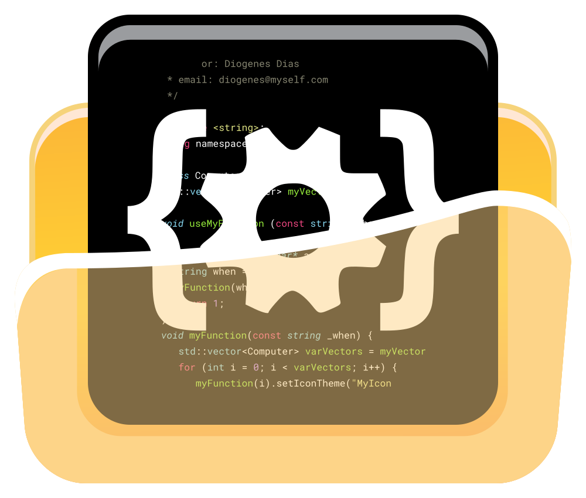

> ---

  

  
<h1 align="center">dPSuite</h1>

> ---

  Suite em PowerShell 7 para configurar e automatizar um ambiente Windows. 
  Reúne a preparação da máquina num só lugar, para repetir o mesmo ambiente quando precisar.

  
  
  
  

> ---
